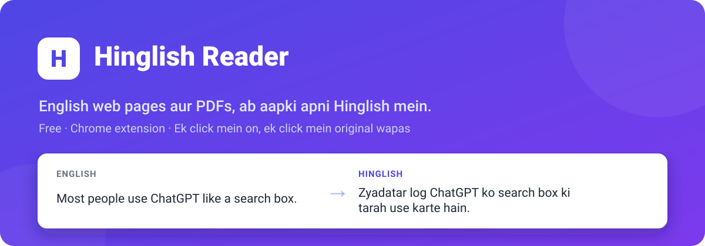
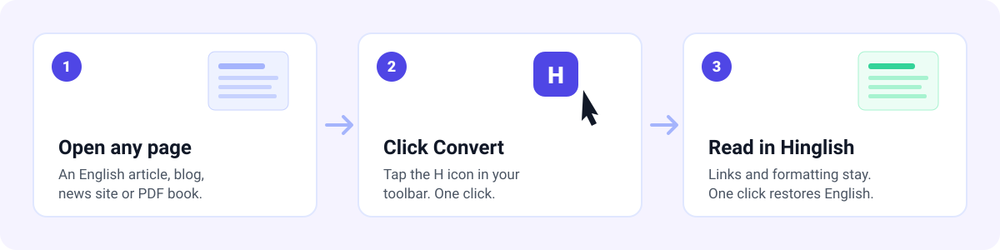
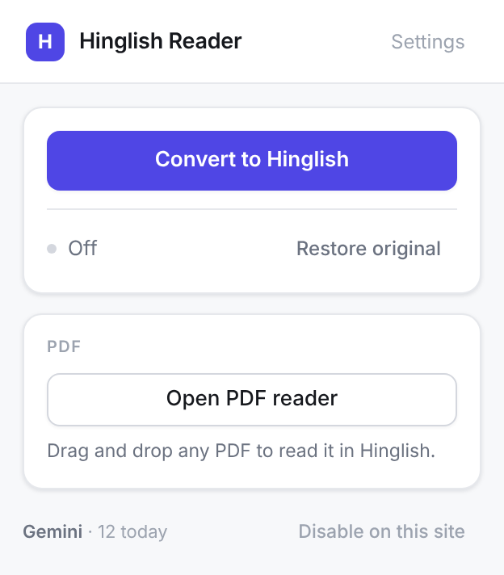
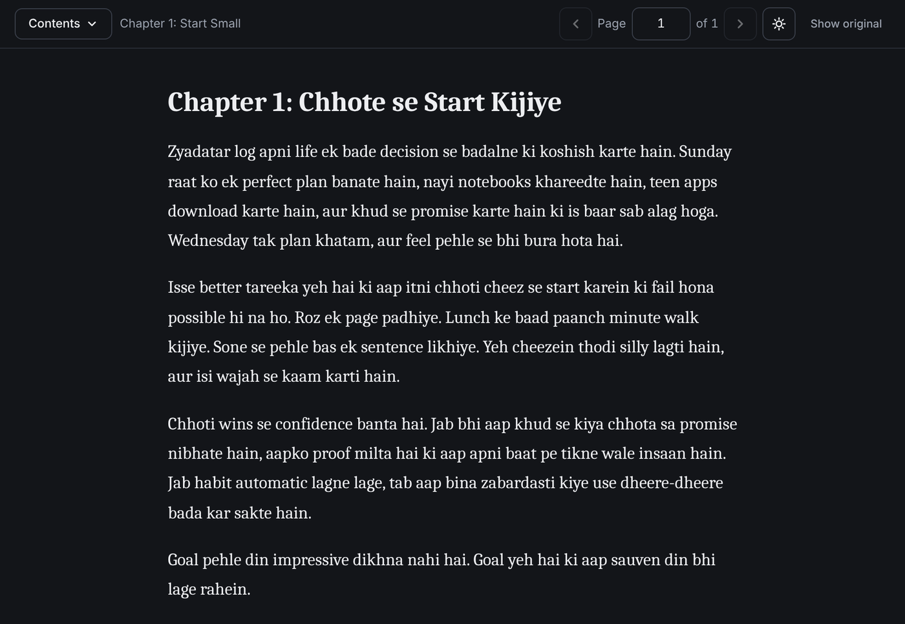
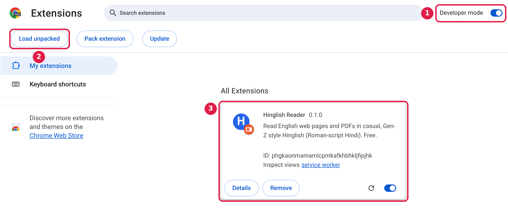
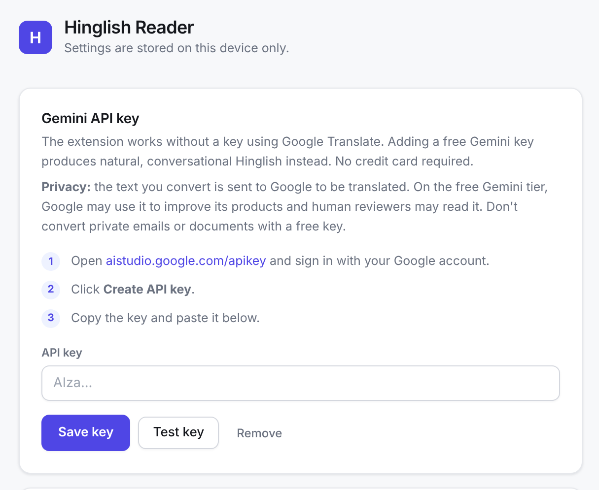

<p align="center">
  
</p>

<p align="center">
  
  
  
  
</p>

<p align="center">
  <b>Read any English web page or PDF book in easy, everyday Hinglish.</b><br>
  Powered by Google Gemini. Free, no credit card. One click to convert, one click to go back.
</p>

<p align="center">
  <a href="#install-in-5-minutes">Install</a> ·
  <a href="#how-to-use">How to use</a> ·
  <a href="#add-your-free-gemini-key-2-minutes">Gemini key</a> ·
  <a href="#privacy">Privacy</a> ·
  <a href="#troubleshooting">Troubleshooting</a>
</p>

---

## How it works

<p align="center">
  
</p>

## Features

- **Natural Hinglish, powered by Google Gemini.** Sounds the way people actually talk and text, and always addresses you respectfully as "aap".
- **Web pages.** Convert any English article, blog or news page. Links, bold text and images stay where they were.
- **PDF books.** Drop in a PDF and read it page by page, with a Contents menu, dark mode, and your last page remembered.
- **Right-click.** Select any text, right-click, and choose **Read in Hinglish**.
- **Instant undo.** **Restore original** puts the page back exactly as it was.
- **Safe by default.** Never runs on banking, payment or login pages.

<table>
  <tr>
    <td width="32%" align="center"><br><sub>Toolbar popup</sub></td>
    <td width="68%" align="center"><br><sub>PDF reader, dark mode (illustration of Gemini-mode Hinglish)</sub></td>
  </tr>
</table>

---

## Install in 5 minutes

Hinglish Reader is not on the Chrome Web Store yet, so you install it once by hand. No coding needed.

### Step 1: Download

1. At the top of this page, click the green **`<> Code`** button.
2. Click **Download ZIP**.

### Step 2: Unzip and keep the folder

1. **Windows:** right-click the ZIP file, choose **Extract All…**, then **Extract**.
   **Mac:** double-click the ZIP file.
2. Move the new folder somewhere permanent, such as **Documents**.

> [!WARNING]
> Don't delete or move this folder later. Chrome runs the extension from it, so removing the folder removes the extension.

### Step 3: Load it into Chrome

1. Type `chrome://extensions` into Chrome's address bar and press **Enter**.
2. Turn on **Developer mode** (top-right corner). **①**
3. Click **Load unpacked** (top-left). **②**
4. Select the folder from Step 2 and click **Select Folder**. The right folder is the one that contains `manifest.json`.
5. **Hinglish Reader** now appears in your list. **③**

<p align="center">
  
</p>

> [!TIP]
> On Windows the ZIP often creates a folder inside a folder with the same name (`hinglish-extension-main` → `hinglish-extension-main`). Choose the inner one, the one with `manifest.json` inside.

### Step 4: Pin it to your toolbar

Click the puzzle icon 🧩 at the top-right of Chrome, then the pin 📌 next to **Hinglish Reader**. A purple **H** icon appears in your toolbar.

### Step 5: Add your free Gemini key

The Settings page opens by itself after install. Follow the [Gemini key steps below](#add-your-free-gemini-key-2-minutes) (about 2 minutes, no credit card). You're done. ✅

---

## How to use

**On a web page**

1. Open any English page and click the **H** icon.
2. Click **Convert to Hinglish**.
3. What's on screen converts first. Keep scrolling and the rest follows.
4. A small button at the bottom-right of the page shows progress. Click it to restore the original.

**With a PDF book**

1. Click the **H** icon, then **Open PDF reader**.
2. Drag your PDF onto the page, or click **Choose PDF**.
3. Each page converts when you open it, so your free quota lasts longer.

**For a single line**

Select the text, right-click, and choose **Read in Hinglish**.

---

## Add your free Gemini key (2 minutes)

Hinglish Reader is built for Google Gemini. A free key is what gives you **natural, conversational Hinglish**. It takes about 2 minutes and needs no credit card.

1. Click the **H** icon, then **Settings** (top-right).
2. Open [aistudio.google.com/apikey](https://aistudio.google.com/apikey) and sign in with your Google account.
3. Click **Create API key** and copy it.
4. Paste it into Settings, click **Save key**, then **Test key**.

When you see **Everything works**, you're ready.

<p align="center">
  
</p>

- **It stays free.** Free keys have no billing.
- **Backup only.** If the key is missing or today's limit is used up, a limited Basic mode (Google Translate) keeps pages readable until Gemini is back. It sounds more formal, so keep your key added.
- **Daily reset.** The limit resets at midnight Pacific time (around 12:30 PM or 1:30 PM in India). The extension shows the exact reset time in your own time zone.
- **Keep your key private.** Never share it or post it online. It's stored only in Chrome on your computer.

---

## Privacy

| What | Where it goes |
|---|---|
| Your settings and Gemini key | Only your computer, inside Chrome. Never synced or uploaded. |
| Text you choose to convert | Google, for translation (Google Translate, or Gemini if you added a key). |
| Your browsing, history and passwords | Nowhere. The extension only reads a page when you click Convert. |

Hinglish Reader has no server of its own, no tracking and no analytics.

> [!IMPORTANT]
> On the free Gemini tier, Google may use the text you send to improve its products, and human reviewers may read it ([Gemini API terms](https://ai.google.dev/gemini-api/terms)). **Don't convert private emails, bank statements or personal documents with a free key.**

---

## Where it won't run

- **Banking and payment sites** (net banking, Paytm, PhonePe, PayPal and similar). Always off, for your safety.
- **Login and checkout pages** that have a password field. Always off, for your safety.
- **`chrome://` pages and the Chrome Web Store.** Chrome doesn't allow extensions there.
- **Scanned or photo PDFs.** They contain images, not text. If you can select the text in a PDF, it will work.

To turn it off on any site: click the **H** icon, then **Disable on this site**. Turn it back on from **Settings → Disabled sites**.

---

## Troubleshooting

| Problem | Fix |
|---|---|
| "Manifest file is missing or unreadable" | You picked the wrong folder. Choose the one that contains `manifest.json` (see the tip in Step 3). |
| The extension disappeared | The folder was moved or deleted. Repeat the install from Step 1. |
| Nothing changed after clicking Convert | Reload the page and click **Convert to Hinglish** again. |
| The corner button says "Basic mode" or "Limit reached" | No Gemini key yet (add it in Settings), or today's free limit is used up and it resets later today. |

## Updating

1. Download the new ZIP (Steps 1 and 2).
2. Replace the files in your existing folder with the new ones. Keep the folder in the same place.
3. Open `chrome://extensions` and click the reload icon ↻ on Hinglish Reader.

Your key and settings are kept.

## Uninstalling

Open `chrome://extensions`, find Hinglish Reader, and click **Remove**. You can then delete the folder. This also deletes your saved key and settings.

---

## Good to know

- Not every sentence will be perfect, especially very technical or very long ones.
- Tested on desktop Google Chrome.

Found a problem or have an idea? [Open an issue](https://github.com/TKM649/HINGLISH-EXTENSION/issues).

---

<details>
<summary><b>For developers</b></summary>

<br>

There is no build step: Chrome loads the files in this folder as they are. `package.json` only provides `jsdom` for the test suite; the extension has no runtime dependencies.

```
manifest.json     Extension config (Manifest V3)
background.js     All network calls (Google Translate + Gemini), model choice, context menu
gemini.js         Gemini prompt and response parsing (pure)
glossary.js       Word list for Basic mode
hinglishify.js    Applies the glossary rules (pure)
cache.js          Translation cache (memory + chrome.storage.local)
safety.js         Where the extension must stay off (pure)
content.js/css    In-page logic: text extraction, viewport queue, DOM updates, restore
popup.html/js     Toolbar popup
options.html/js   Settings page
reader.html/js    PDF reader
pdf-text.js       Rebuilds headings and paragraphs from PDF text (pure)
markers.js        Formatting-marker parser (pure)
vendor/           Mozilla PDF.js (prebuilt, Apache-2.0, unmodified)
```

Run the tests (Node only, no browser needed):

```bash
npm install
```

```bash
npm test
```

Architecture notes are in [CLAUDE.md](CLAUDE.md).

</details>

---

## License

Copyright © 2026 Tarun ([@TKM649](https://github.com/TKM649)).

Hinglish Reader is free software under the [GNU General Public License v3.0](LICENSE). You may use, study, share and modify it. If you distribute a modified version, it must stay open source under the same license and keep this copyright notice.

The name **"Hinglish Reader"** and the **H** logo are not licensed for reuse: forks must use their own name and logo (GPL-3.0 section 7(e)).

Bundled [PDF.js](https://github.com/mozilla/pdf.js) is © Mozilla Foundation, licensed under Apache-2.0.
